# TextMate

## Download

Install this fork via Homebrew:

```sh
brew install --cask tectiv3/textmate/textmate
```

Or download a signed and notarized build from the [releases page](https://github.com/tectiv3/textmate/releases).

The official (upstream) TextMate is available [from macromates.com](https://macromates.com/download).

## Feedback

Use [GitHub Issues](https://github.com/tectiv3/textmate/issues) for bug reports and feature requests.

## Screenshot


## Screenshots

### Command Palette

<p align="center">
  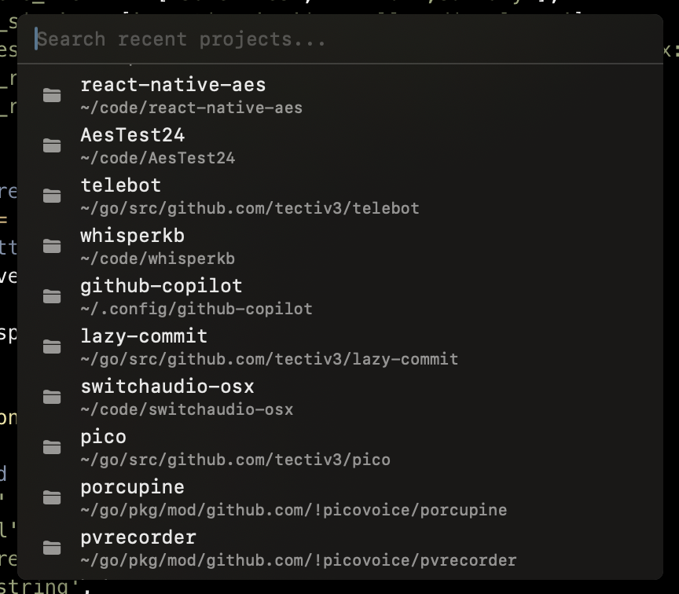
  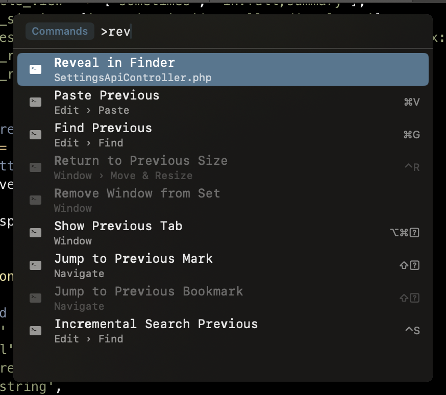
</p>
<p align="center">
  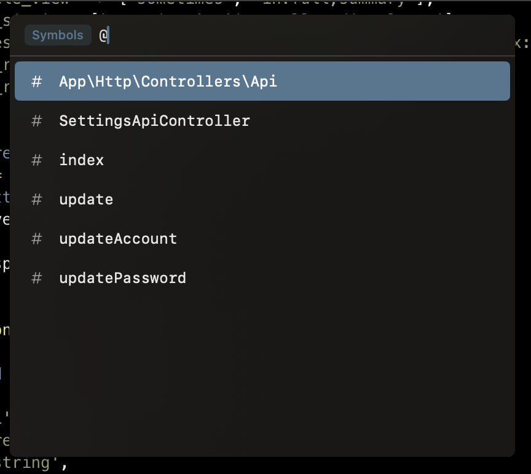
  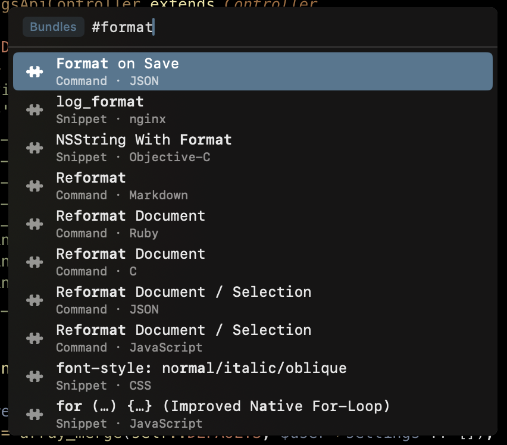
</p>
<p align="center">
  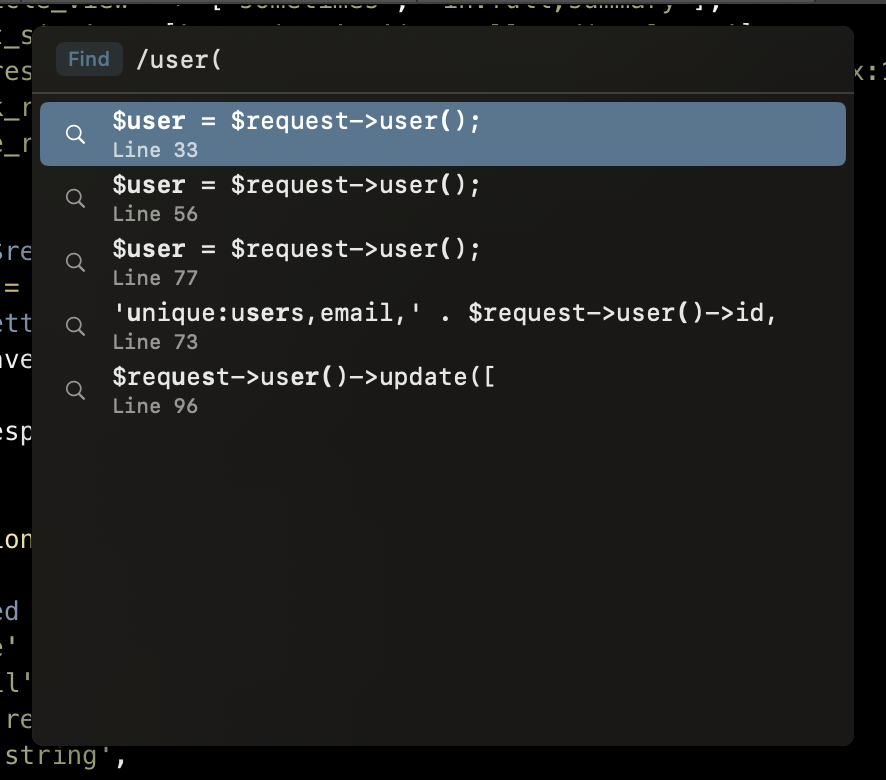
  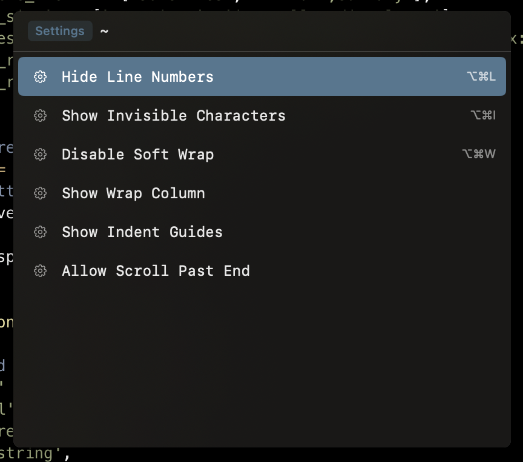
</p>

### LSP

<p align="center">
  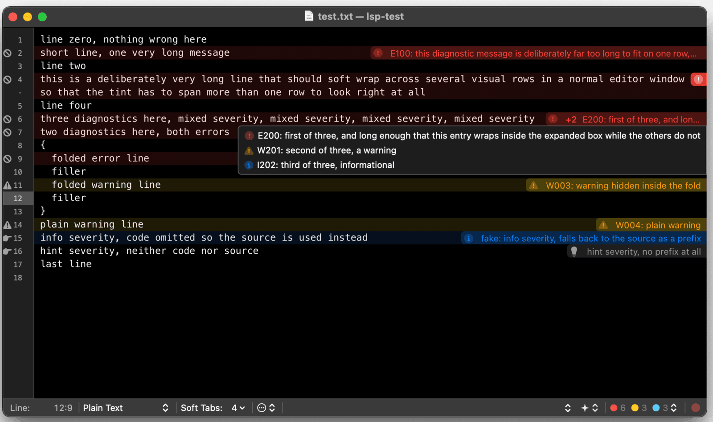
</p>
<p align="center">
  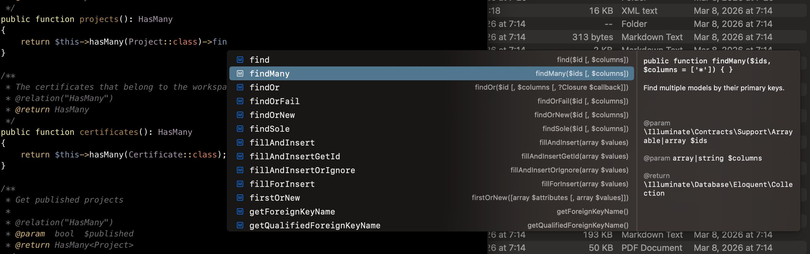
</p>
<p align="center">
  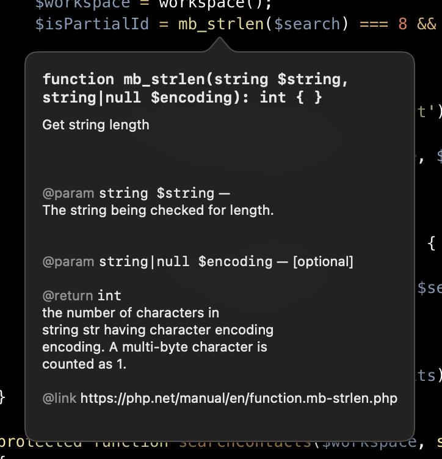
  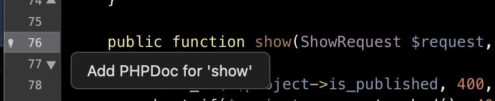
</p>
<p align="center">
  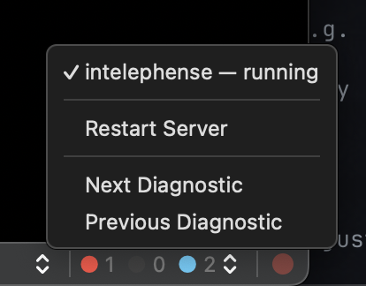
</p>

### Copilot

<p align="center">
  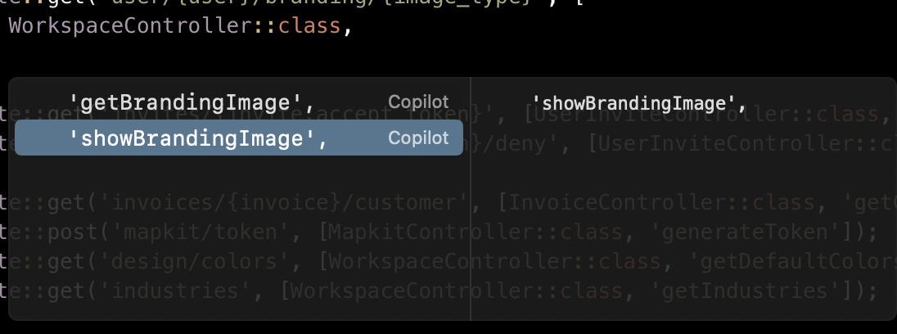
</p>
<p align="center">
  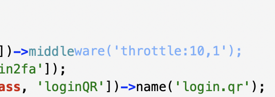
  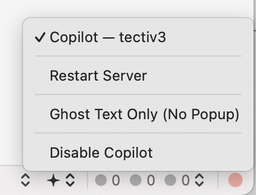
</p>

### Terminal

<p align="center">
  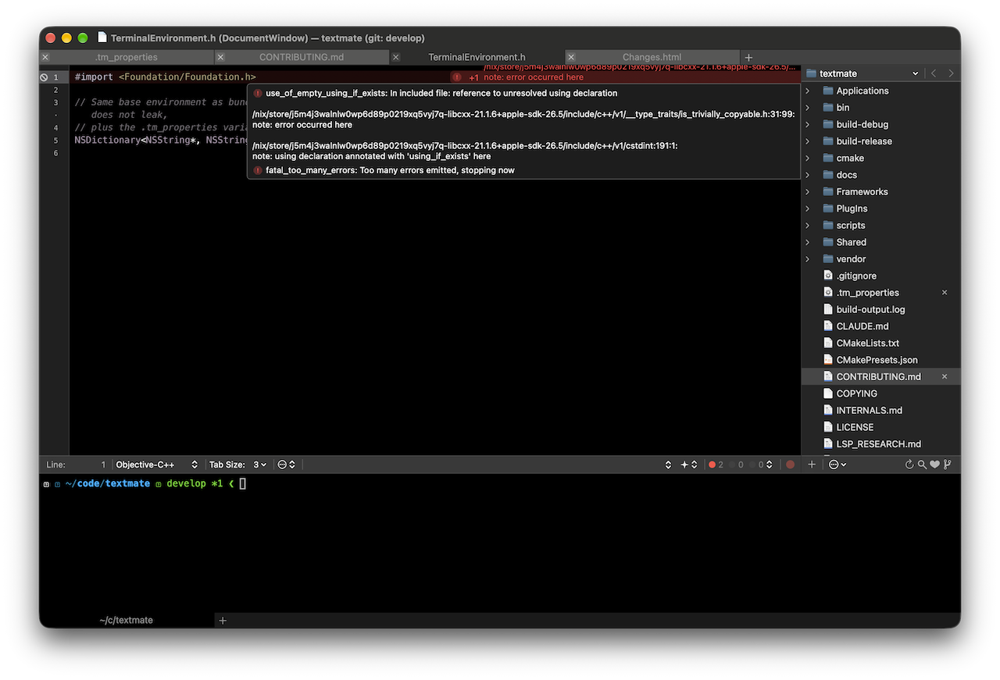
</p>

Every document window has its own terminal panel, docked at the bottom by default. It can also dock at the left or right. The panel follows the editor's font, zoom level and theme colours, even when no project or document is open.

# Building

## Requirements

 * macOS 14.0 (Sonoma) or later
 * Xcode with Swift 6.2 or later (full install, not just Command Line Tools — `ibtool` and `actool` are required).
   Make sure the active developer directory points to Xcode: `sudo xcode-select -s /Applications/Xcode.app/Contents/Developer`
 * [ninja][]            — build system similar to `make`
 * [cmake][] ≥ 3.21     — meta build system

All dependencies can be installed using [Homebrew][]:

```sh
brew install ninja cmake
```

## Setup

```sh
git clone https://github.com/tectiv3/textmate.git
cd textmate
make run
```

Onigmo, kvdb, the document icons, and CxxTest are included directly in this
repository. No submodule initialization or external dependency checkout is
required.

## Build Commands

```sh
make debug           # Incremental debug build (ASan enabled)
make release         # Incremental release build (LTO, no ASan)
make run             # Build debug and launch
make clean           # Remove all build dirs
```

## Dependencies Removed

| Dependency | Status | Replacement |
|-----------|--------|-------------|
| Old rave build system (62 files) | Removed | CMake + Ninja |
| multimarkdown + bin/gen_html | Removed | Pre-converted HTML |
| Cap'n Proto | Replaced | NSKeyedArchiver |
| google-sparsehash | Replaced | `std::unordered_map` |
| ragel | Replaced | Hand-written parser |
| boost (variant + crc) | Replaced | `std::variant` + zlib `crc32` |

## Command Palette

Press **Cmd+Shift+P** to open the command palette — a unified fuzzy-search interface for navigating TextMate. Type a prefix to switch modes:

| Prefix | Mode | What it does |
|--------|------|-------------|
| (none) | Recent Projects | Open a recent project |
| `>` | Commands | Run any menu action or bundle command |
| `@` | Symbols | Jump to a symbol in the current document |
| `#` | Bundle Editor | Open a grammar, snippet, or command in the bundle editor |
| `:` | Go to Line | Jump to a line number |
| `/` | Find in Project | Open Find in Project with a pre-filled query |
| `~` | Settings | Toggle editor settings (soft wrap, invisibles, etc.) |

Results are ranked by fuzzy match score. Frequently used items are boosted over time.

**File → Manage Recent Projects** opens a command palette for recent and favorite projects. Mark multiple results to open them together, or use the remove control to clear an entry. Removing an entry leaves its project files in place.

## Theme Editor

Opening a file selects its syntax from the first line or filename extension. The app includes basic offline highlighting for C, C++, CSS, Go, HTML, JavaScript, JSON, Markdown, Objective-C, Python, Rust, shell scripts, Swift, TypeScript, and YAML. Installed language bundles provide the full grammars and take precedence over the built-in versions.

Choose **View → Theme → Open Theme Editor…** or run `tm-theme-editor` to open the native macOS theme editor bundled with TextMate. Its three panes show the installed themes, color and font controls, and a live preview using TextMate's own editor, syntax highlighting, gutter, and selection rendering.

Markdown Preview follows the Light, Dark, or Auto appearance selected in **View → Theme**. The Markdown source editor uses the selected editor theme, including any colors that theme defines for Markdown syntax.

Select a theme to edit its global style or individual syntax scope rules. Use **+** for a blank theme, right-click a theme for **Duplicate**, **Delete**, or **Export…**, and use **Save Theme** (**Cmd+S**) to write changes. **File → Export Theme…** exports the current draft to a local `.tmTheme` file with a fresh UUID, preserving other metadata. Edits to bundled themes are stored as local overrides; new themes appear in TextMate's theme menu. Unsaved changes remain private to the preview, and switching themes or quitting offers **Save**, **Cancel**, and **Revert Changes**.

The executable lives at `TextMate.app/Contents/MacOS/tm-theme-editor`. For a development build, run:

```sh
build-debug/Applications/TextMate/TextMate.app/Contents/MacOS/tm-theme-editor
```

To run it by name, add the app's `Contents/MacOS` directory to your shell's `PATH`, or create a symlink to the executable in a directory already on your `PATH`.

See [Theme Editor](docs/theme-editor.md) for editing and storage details.

## Project Sidebar

Use **View → Show File Browser** and **View → Show Outline** to show the Project and Outline sections in one sidebar. Click either section title to collapse or expand it. With both sections expanded, drag the line above Outline to adjust its height. The sidebar defaults to the left; move it in **Settings → Projects** or drag its outer edge to adjust its width.

## Project Changes

Choose **View → Show Project Changes** to review changed files across the repository against the last Git commit. The window includes staged, unstaged, new, deleted, and unsaved named files, with colored diffs, previous/next change navigation, and an **Open File** action. It refreshes while open. See [Project Changes](docs/project-changes.md) for details.

## LSP Support

TextMate has built-in Language Server Protocol support for diagnostics and completions. When you open a supported file, TextMate chooses an installed server from its extension. It looks in the project’s `.venv/bin`, `venv/bin`, and `node_modules/.bin`, then in `~/go/bin`, `~/.cargo/bin`, `~/.local/bin`, Homebrew directories, and TextMate’s `PATH`. This also finds `gopls` installed with `go install` when TextMate is launched from Finder, where the shell’s `PATH` is unavailable. Unrecognized extensions and unavailable servers do not start an LSP.

| Files | Default server |
|-------|----------------|
| `.rs` | `rust-analyzer` |
| `.go` | `gopls` |
| `.py`, `.pyw` | `pyright-langserver --stdio`, then `pylsp` |
| `.rb` | `ruby-lsp` |
| `.c`, `.h`, `.cc`, `.cpp`, `.cxx`, `.hh`, `.hpp`, `.hxx`, `.m`, `.mm` | `clangd` |
| `.sh`, `.bash`, `.zsh` | `bash-language-server start` |
| `.java` | `jdtls` |

Other defaults cover JavaScript/TypeScript, PHP, Lua, Swift, JSON, CSS, HTML, YAML, Vue, Svelte, Markdown, TOML, Terraform and Kotlin. Install the corresponding language server first, or specify `lspCommand` below to use another one. For Java, install a `jdtls` launcher executable; a JDK alone does not include it.

Configure or override the server per-project in `.textmate` (the shorter replacement for the legacy `.tm_properties` name — both are supported, `.textmate` wins when a directory has both):

### PHP (intelephense)

```
# .textmate
[ *.php ]
lspCommand = "intelephense --stdio"
lspInitOptions = '{"licenceKey":"YOUR-KEY-HERE","clearCache":true}'
```

### Go (gopls)

```
# .textmate
[ *.go ]
lspCommand = gopls
```

### C/C++/Objective-C (clangd)

```
# .textmate
[ *.{c,cc,cpp,h,hpp,m,mm} ]
lspCommand = clangd
```

### Python (pyright)

```
# .textmate
[ *.py ]
lspCommand = "pyright-langserver --stdio"
```

### Python (pylsp)

Alternative Python server with plugin ecosystem (ruff, mypy, black):

```
# .textmate
[ *.py ]
lspCommand = pylsp
```

To disable specific plugins (e.g. mypy if it can't find your project's dependencies):

```
# .textmate
[ *.py ]
lspCommand = pylsp
lspInitOptions = '{"pylsp": {"plugins": {"pylsp_mypy": {"enabled": false}}}}'
```

If you need pylsp to resolve project-specific packages, install it inside your project's virtualenv instead of using the global one.

### Vue/TypeScript (Volar 2.x)

Volar 2.0+ uses Hybrid Mode with `typescript-language-server` for script support:

```
# .textmate
[ *.{vue,ts,tsx,js,jsx} ]
lspCommand = "$TM_PROJECT_DIRECTORY/node_modules/.bin/typescript-language-server --stdio"
lspInitOptions = '{ "plugins": [{ "name": "@vue/typescript-plugin", "location": "./node_modules/@vue/language-server", "languages": ["vue"] }] }'
```

### Rust (rust-analyzer)

```
# .textmate
[ *.rs ]
lspCommand = rust-analyzer
```

### Lua (lua-language-server)

```
# .textmate
[ *.lua ]
lspCommand = lua-language-server
```

### Bash (bash-language-server)

```
# .textmate
[ *.{sh,bash,zsh} ]
lspCommand = "bash-language-server start"
```

### Ruby (ruby-lsp)

```
# .textmate
[ *.rb ]
lspCommand = ruby-lsp
```

### Swift (sourcekit-lsp)

Requires Xcode. Project must have a `Package.swift` or `compile_commands.json`.

```
# .textmate
[ *.swift ]
lspCommand = "xcrun sourcekit-lsp"
```

### Settings

| Property | Description |
|----------|-------------|
| `lspCommand` | Command to launch the language server; overrides automatic selection for matching files. Set to an empty string to disable automatic selection. |
| `lspEnabled` | Set to `false` to disable LSP for matching files (default: `true`) |
| `lspRootPath` | Override workspace root detection |
| `lspInitOptions` | JSON object passed as `initializationOptions` to the server |
| `lspFormatOnSave` | Set to `true` to format via LSP before saving (default: `false`) |
| `formatCommand` | Shell command for an external formatter (stdin/stdout, overrides LSP formatting) |
| `formatOnSave` | Set to `true` to format before saving — uses `formatCommand` if set, else LSP (default: `false`) |

Press **Ctrl+Space** to trigger LSP completions. Diagnostics (errors, warnings) appear automatically in the gutter.

### Debugging

Open the LSP debug panel via **Text → LSP → Debug Panel**. Shows all JSON-RPC traffic, server stderr, errors, and lifecycle events. Use the filter field to narrow by server name or message content.

## GitHub Copilot

TextMate supports GitHub Copilot inline completions (ghost text). Requires a GitHub Copilot subscription.
Copilot is disabled by default.

### Installation

Install `copilot-language-server` (the modern native binary):

```sh
npm install -g @github/copilot-language-server
```

Or via nix:

```nix
environment.systemPackages = [ pkgs.copilot-language-server ];
```

Enable Copilot from the status bar menu, or set `copilotEnabled = true` in `.textmate`.
When enabled, TextMate auto-detects the binary from `$PATH`. To override, set `copilotCommand`:

```
copilotEnabled = true
copilotCommand = /path/to/copilot-language-server
```

### Settings

| Property | Description |
|----------|-------------|
| `copilotCommand` | Path to copilot-language-server binary (overrides auto-detect) |
| `copilotEnabled` | Set to `true` to enable Copilot for matching files (default: `false`) |

### Usage

When enabled and signed in, Copilot suggestions appear automatically as ghost text while typing. Press **Tab** to accept, **Esc** to dismiss.

### Enabling

Set `copilotEnabled = true` in `.textmate`. Like all TextMate settings, it can be scoped globally, per-project, or per-file-type:

```
# ~/.textmate — enable everywhere
copilotEnabled = true

# project .textmate — enable for one file type
[ *.md ]
copilotEnabled = true
```

### Formatting

Format the current document via **Text → Format Code**. Enable format-on-save per file type.

#### Custom Formatter

You can use any external formatter that reads stdin and writes formatted output to stdout. When `formatCommand` is set, it takes priority over LSP formatting for that file type. Standard TextMate variables (`TM_FILEPATH`, `TM_TAB_SIZE`, `TM_SOFT_TABS`, etc.) are available to the command. The working directory is set to the project root so tools find their config files.

**Note:** Quote the command if it contains arguments.

```
# .textmate

# JavaScript/TypeScript with Prettier
[ *.{js,jsx,ts,tsx} ]
formatCommand = "prettier --parser=typescript"
formatOnSave  = true

# PHP with Prettier
[ *.php ]
formatCommand = "prettier --parser=php"
formatOnSave  = true

# Python with Black
[ *.py ]
formatCommand = "black -q -"
formatOnSave  = true

# Rust with rustfmt
[ *.rs ]
formatCommand = rustfmt
formatOnSave  = true

# Go with gofmt
[ *.go ]
formatCommand = gofmt
formatOnSave  = true

# C/C++/ObjC with clang-format
[ *.{c,cc,cpp,h,hpp,m,mm} ]
formatCommand = clang-format
formatOnSave  = true
```

#### LSP Formatting

For file types without a `formatCommand`, formatting falls back to the language server (if it supports `textDocument/formatting`):

```
# .textmate
[ *.php ]
formatOnSave = true
```

The legacy `lspFormatOnSave` key still works for backward compatibility.

## Multi-root Workspaces

Choose **File → Open Workspace…** to open a VS Code `.code-workspace` file, or **File → New Workspace…** to save the current project as a workspace. Use **Add Folders to Workspace…** and **Remove Folder from Workspace…** to edit the folder list. Removing a folder leaves its files and open tabs in place.

Each folder in **Project** has its own disclosure arrow. Workspace files support local `folders[].path` and optional `name` aliases, including paths relative to the workspace file. Folder edits preserve other top-level configuration. Open tabs, the fallback folder, and tree expansion are stored in TextMate's local session, not in the shared file.

**Find in Project** searches all workspace folders; choose **Workspace Folder** in the Find scope menu to search one. **Open Quickly**, Git, and new terminals use the selected document's folder (the most specific one if folders overlap). Choose a fallback folder in the Project location menu for files outside those folders or when no file is open. Existing terminal sessions keep their original directory.

**Open Quickly** (`⌘T` by default) uses a floating search palette. Search by file name or relative path, use the arrow keys and Return to open a result, and append `:line` to jump to a line (for example, `main.go:42`). The scope menu switches between all project files, open documents, and uncommitted documents.

## Run & Debug

Choose **Run → Show Run & Debug** to open the Run & Debug section alongside Project and Outline. Click its disclosure arrow to collapse it without changing the other sections. The configuration list includes the owning folder in a workspace. The green play button debugs supported Go launch configurations and runs tasks and other supported launch configurations without a debugger. Choose **Run Without Debugging** from the ellipsis menu or press **Control-F5** to run without attaching. **Hide Run & Debug** removes only that section; it does not stop the session or close Output.

Starting a configuration opens **Output** in a floating panel, without resizing the editor or replacing the Terminal. The panel shows combined output and exit status, including ANSI foreground colors. Drag its header toward a display edge to see an accent appear and feel the panel ease into a firm snap. It sticks while you slide along the edge; pull farther inward to detach or drag across to another display. Dropping just across the seam keeps the panel open on the destination display. Release while snapped and the panel curves into a slim tab with a Genie-style animation. Hover over or click the tab to reverse the animation; moving the pointer away tucks it again. With macOS Reduce Motion enabled, Output switches without the animation. Click the pin in the Output header to keep the panel expanded and above regular windows, even while working in another app. Click it again to restore auto-hide at a docked edge. Close Output without stopping the process, and reopen the log with **Run → Show Output**. The first run of a resolved command plan asks for confirmation in each window; changed commands or folders require approval again.

Use **Run → Configure Run & Debug…** or the gear beside the configuration picker to open `.vscode/launch.json` in TextMate. In a multi-root workspace, choose the folder first. If the file is missing, TextMate creates a VS Code-compatible Go template; it never overwrites an existing file. Save your changes, then select a configuration to run or debug. TextMate does not infer or run a program when no configuration is present.

TextMate reads JSON with comments in each folder's `.vscode/tasks.json` and `.vscode/launch.json`. It supports foreground `process` tasks, local Go launch configurations in `auto` or `debug` mode as `go run`, and the TextMate-specific `textmate-process` launch type for local executables. Launch configurations use `program`, `args`, `cwd`, and `env`; tasks use `command`, `args`, and `options.cwd` / `options.env`. A `preLaunchTask` must name a supported task in the same folder; a failed task prevents launch. Supported variables include `${workspaceFolder}`, `${workspaceFolder:name}`, `${workspaceFolderBasename}`, `${file}`, `${fileDirname}`, `${fileBasename}`, and `${relativeFile}`. File variables require a file in the configuration's folder.

Go launches accept `buildFlags` for both Run and Debug. Use a quoted argument string such as `"-tags dev"` or an array such as `["-tags", "dev"]`. These are passed as separate arguments, without invoking a shell.

For a VS Code `node-terminal` launch, **Run** supports a single executable and arguments (including quoted arguments), optionally prefixed by `cd <directory> &&`. For example, `cd ${workspaceFolder}/app/gbot-gui && wails dev` starts Wails in that directory, with the configuration's `env` applied. These commands run in the output panel, without a shell or JavaScript debugger. Shell and background tasks, compound launches, interactive consoles, pipes, redirects, shell escaping and expansions, and command variables are not supported.

To debug Go, install Go and a compatible Delve (`dlv`) with Unix socket support. TextMate looks for `dlv` on `PATH`, including `~/go/bin` by default. Create a local launch configuration in the owning folder's `.vscode/launch.json`:

```json
{
  "version": "0.2.0",
  "configurations": [
    { "name": "Debug Go", "type": "go", "request": "launch", "mode": "debug", "program": "${workspaceFolder}" }
  ]
}
```

Save your Go files, open **Run & Debug**, and click the leftmost gutter beside a source line or press **F9** to toggle its breakpoint. Breakpoints belong to the window and use saved source line numbers; they are not written to the workspace file. Select the configuration and choose **Debug** (**F5**). The panel asks for permission separately from **Run** and shows any pre-launch task output before starting Delve.

During a debug session, a floating toolbar above the editor holds Continue/Pause, the three step actions, Restart, and Stop. Drag its handle to move it horizontally. Hiding the sidebar or Output does not hide the toolbar. Use **F5** to continue, **F10** to step over, **F11** to step into, **Shift+F11** to step out, **Control+Shift+F5** to restart the last approved plan, or **Shift+F5** to stop. Restart waits for the previous process to stop. Start a new run to use edits to the configuration. `stopOnEntry: true` pauses at launch.

When paused, the execution arrow marks the current line. Use the goroutine picker in **Call Stack** to inspect a different goroutine. Select a frame to open its source and inspect locals and arguments in **Variables**. Expand structured values to inspect their fields. In **Watch**, enter a Go expression and press Return or click **+**. Right-click an expression to edit or remove it. Watches refresh in the selected frame on every pause and are restored with the window.

Select a breakpoint in the sidebar to jump to its source. Right-click it to enable, disable, remove, or edit it. A hollow orange marker means Delve has not verified the breakpoint; hover over the sidebar entry for details. If Delve moves a breakpoint to an executable line, clicking the entry opens that line. An edited breakpoint can have a Go condition, a hit-count expression (such as `>= 3`), or a log message. A logpoint prints to Output instead of pausing; enclose an expression in braces to include its value. This version only debugs local Go launches (`auto` or `debug`); it does not support attach or remote targets. Cursor's **Trace Inspector** comes from the Ruby debugger extension and is not a Delve feature.

## Git Workspace and Source Control

Open a Git project and select **Git** in the title bar. Select **Editor** to return to the same open tabs, or press **Control+Shift+G** to switch between the modes. In Git mode, use the left sidebar to browse the working copy, history, stashes, and local and remote references. The middle pane shows changed files or commits. Select a row to see its diff on the right. In Working Copy, search filters changed files. In History, use the magnifying glass menu to search the selected history by commit message, author, hash, or repository relative file path.

Use the checkboxes to stage or unstage individual files. A collapsed untracked folder counts as one row and can be staged as a unit. **Stage All** switches to **Unstage All** when only staged changes remain. Save unsaved editor changes before staging. Select **Commit Subject** to expand the detailed description and commit options. **Commit** uses the staged changes. Choose **View → Show Source Control Sidebar** to add a compact Source Control section between Project and Outline. Each section can be shown or collapsed independently.

In **Working Copy**, switch between **Staged** and **Unstaged** when the selected file has both kinds of changes. For saved text edits to tracked files, choose a chunk to stage, unstage, or discard separately. **History** shows commit ancestry inline; **History** and **Stashes** both let you expand individual files in **Changeset**, or browse the saved revision under **Tree**.

**Branches Review** compares local branches to a selected base. It shows ahead/behind counts, merge and tracking status, commits, and changed files. Right-click a branch to check it out, pin it, configure tracking, publish it, or create a new branch or tag from it. Conflict simulation uses `git merge-tree --write-tree` when available. Archiving moves a branch into **Archived Branches** while retaining its commits and reflog; restore it from the **Archived** filter. The filter menu also lets you opt in to automatically archiving branches fully merged into the selected local base. Pinned branches, branches in use by a worktree, and branches marked **Skips Auto-Archiving** stay in place.

**Pull Requests** uses [GitHub CLI](https://cli.github.com/). Sign in with `gh auth login`, then choose a GitHub remote to browse, review, check out, create, or merge pull requests. For a GitHub Enterprise remote, set `remote.<name>.textmateGitHubHost` in the repository configuration to its GitHub hostname.

**Settings** edits repository identity, signing, commit templates and prompts, and issue links. The **Ignores** and **Excludes** tabs edit `.gitignore` and the repository’s local exclude rules. Git LFS actions require `git-lfs`, and Git Flow topic actions require `git-flow`. These tools can be installed independently.

Double-click a local branch to check it out. Right-click a remote branch and choose **Check Out as Local Branch** to create a local branch that tracks it. The toolbar has **Quick Actions**, **Fetch**, **Pull**, **Push**, **Sync**, **Merge**, **Rebase**, **Apply Stash**, **Save Stash**, and **Refresh**. Sync pulls the selected remote branch and pushes only after a successful pull. From the repository actions menu you can continue or abort a merge or rebase after a conflict. Remote operations use the repository's configured remotes and Git credentials.

Choose **Stashes → Save Stash** to set aside changes, optionally including untracked files. Right-click a stash to apply it, pop it, or delete it. Apply keeps the stash; Pop removes it after a successful apply. Both can also restore which changes were staged.

## Terminal

Each document window has an embedded terminal panel backed by [SwiftTerm](https://github.com/migueldeicaza/SwiftTerm). Press **Control+`** to show or hide it (View → Show Terminal Panel).

Choose **Left**, **Right**, or **Bottom** under View → Terminal Panel Position. Drag the divider to resize it; the placement and size are remembered and seed new windows. Floating Terminal is temporarily disabled, and saved floating placements open at the bottom.

Showing the panel focuses the terminal, hiding it returns focus to the editor. Each window starts one login shell (your account's shell) in the project folder, falling back to the file browser root, the current document's folder, and then your home folder, with TextMate's environment plus the `.textmate` variables for that directory. Opening another document afterwards does not move a running shell.

| Action | Key |
|--------|-----|
| Show/hide panel | **Control+`** |
| New session | **+** in the tab bar |
| Next/previous session | **Cmd+Opt+→** / **Cmd+Opt+←** (terminal focused) |
| Clear screen and scrollback | **Cmd+K** (terminal focused) |

Sessions keep running while the panel is hidden or a tab is inactive, and tabs can be reordered by dragging. A session can be moved to its own window from the tab's context menu or by double-clicking the tab. Closing a window or quitting asks first when a session runs a foreground program. Sessions end when TextMate quits.

### Opening Files From Output

Hold **Command** to underline a file reference in the output, then **Command-click** to open it in the same window, jumping to the `line:column` when the reference has one. Absolute, `~/`, quoted, and `file://` paths are recognised; relative paths resolve against the shell's working directory, which is tracked per session including inside nested shells (`bash`, `nix-shell`).

### Settings

There is no preferences pane for the terminal; placement and size are stored in user defaults:

| Default | Description |
|---------|-------------|
| `terminalPanelPlacement` | Panel placement: `floating` (default), `left`, `right`, or `bottom` |
| `terminalPanelWidth` | Panel width in points when docked left or right (default: `320`) |
| `terminalPanelHeight` | Panel height in points when docked at the bottom (default: `220`) |

See [docs/embedded-terminal.md](docs/embedded-terminal.md) for the complete behaviour, including session detaching and multi-shell handling.

# Legal

The source for TextMate is released under the GNU General Public License as published by the Free Software Foundation, either version 3 of the License, or (at your option) any later version.

TextMate is a trademark of Allan Odgaard.

[ninja]:         https://ninja-build.org/
[cmake]:         https://cmake.org/
[Homebrew]:      https://brew.sh/
